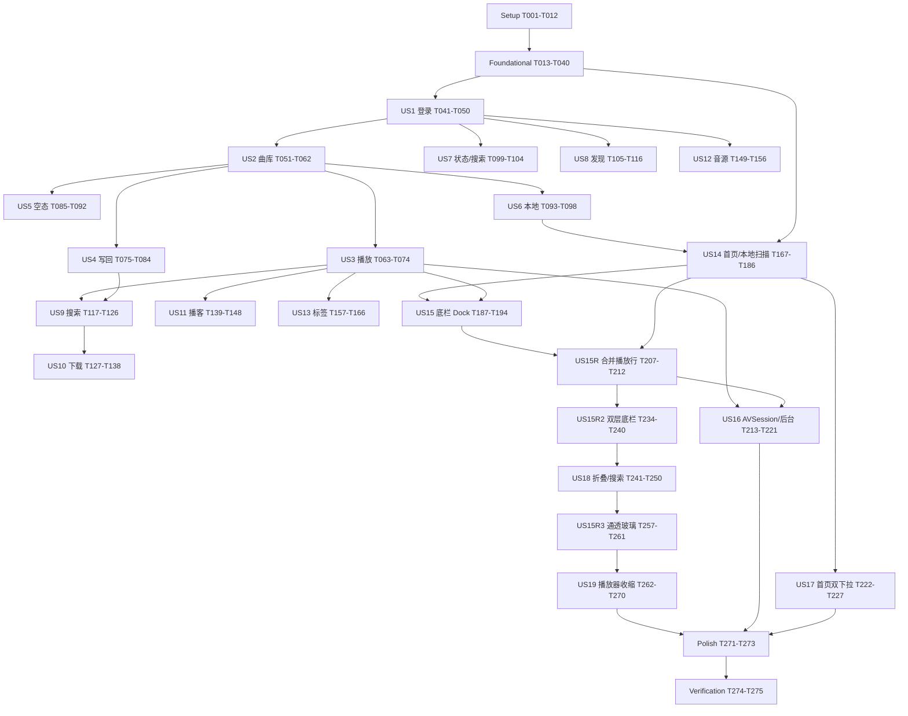

# Tasks: LMPlayer 柠檬音乐 · 服务器全功能接入

**Input**: Design documents from `spec/lmplayer-harmony-port/`
**Prerequisites**: `spec.md`（v3，13 US / 95 FR / 22 SC）、`plan.md`（v3 架构与契约）

**Tests**: 规格未要求 TDD；验证采用编译 + 部署 + UI 交互 + 真实接口 smoke。

**Organization**: Setup → Foundational → 13 个用户故事（P1→P3）→ Polish → Verification。

**工程根**: `E:\lm-music\harmony\`
**源码头**: `E:\lm-music\harmony\entry\src\main\ets\`
**资源头**: `E:\lm-music\harmony\entry\src\main\resources\`

## Format: `[ID] [P?] [Story] Description`

- **[P]**: 不同文件、无未完成依赖，可并行
- **[Story]**: 仅用户故事阶段携带（US1–US13）
- 每个任务均带精确文件路径

## Path Conventions

- 页面：`entry/src/main/ets/pages/`
- 业务视图：`entry/src/main/ets/views/`
- 通用组件：`entry/src/main/ets/components/`
- 播放器：`entry/src/main/ets/player/`
- 状态层：`entry/src/main/ets/viewmodel/`
- 模型：`entry/src/main/ets/model/`
- 服务：`entry/src/main/ets/service/`
- 数据/缓存：`entry/src/main/ets/data/`
- 公共：`entry/src/main/ets/common/`
- 资源：`entry/src/main/resources/`（不得放入 `ets/`）

---

## Phase 1: Setup (Shared Infrastructure)

**Purpose**: 配置网络权限、常量、服务端基础模型，并移除演示数据。

- [X] T001 确认现有工程基线：在 `E:\lm-music\harmony` 执行 `devecocli build --build-mode debug` 与 `devecocli check arkts`，记录通过状态
- [X] T002 在 `E:\lm-music\harmony\entry\src\main\module.json5` 增加 `ohos.permission.INTERNET` 请求权限，保留沉浸光感 metadata 与 routerMap
- [X] T003 清理 `E:\lm-music\harmony\entry\src\main\ets\common\Constants.ets`：删除 DEMO_* 常量与 SEED_VERSION，新增服务端超时、缓存键、封面缓存上限、Token 过期键、音源默认值
- [X] T004 创建 `E:\lm-music\harmony\entry\src\main\ets\common\ServerEndpoints.ets`：路径常量、`base + path` 拼接、`encodeURIComponent` 查询编码、音质 key 映射、服务器地址规范化
- [X] T005 修改 `E:\lm-music\harmony\entry\src\main\ets\common\Logger.ets`：新增 `redact()`，过滤 Authorization/Token/password/ticket 字段
- [X] T006 修改 `E:\lm-music\harmony\entry\src\main\ets\common\Utils.ets`：新增 md5（或稳定哈希）、并发限制器、退避重试、请求序号生成
- [X] T007 [P] 删除演示数据源：`E:\lm-music\harmony\entry\src\main\ets\data\DemoCatalogMedia.ets`、`DemoCatalogPodcast.ets`、`data\SeedService.ets`、`service\DownloadSimulator.ets`
- [X] T008 [P] 删除演示音频：`E:\lm-music\harmony\entry\src\main\resources\rawfile\music\demo_01.wav` 至 `demo_04.wav`
- [X] T009 创建 `E:\lm-music\harmony\entry\src\main\ets\model\ServerModels.ets`：ServerSession/ConnectionStatus/ServerTrack/OnlineRef/ServerAlbum/ServerArtist/ServerPlaylist/PlaylistEntry/ServerUserData/SyncState/ServerDownloadTask/PodcastFeed/PodcastEpisode/SourceScript/SourcePlatform/TagInfo/TagCandidate/CoverRef
- [X] T010 修改 `E:\lm-music\harmony\entry\src\main\ets\model\MediaModels.ets`：MediaSource 改为 LOCAL/SERVER_FILE/ONLINE/PODCAST；Song 与 PlayableItem 增加服务器/在线/播客字段
- [X] T011 修改 `E:\lm-music\harmony\entry\src\main\ets\model\SettingsModels.ets`：ServerConfig 增加 tokenExpiresAt/lastSyncAt/displayName/status；Preferences 增加 source/keyword 默认值
- [X] T012 执行 `devecocli build --build-mode debug`，修复模型与删除演示文件导致的引用错误（此阶段允许临时注释旧引用）

**Checkpoint**: 网络权限与模型基线就绪，演示文件已移除。

---

## Phase 2: Foundational (Blocking Prerequisites)

**Purpose**: 所有用户故事共享的 HTTP、会话、同步、播放解析、封面、歌词与 UI 状态基础。

**⚠️ CRITICAL**: 未完成本阶段不得开始任何用户故事。

- [X] T013 创建 `E:\lm-music\harmony\entry\src\main\ets\data\ServerSchemas.ets`：登录/曲库/专辑/歌手/歌单/用户数据/发现/搜索/下载/播客/音源/标签的 Raw DTO 与逐字段校验函数
- [X] T014 创建 `E:\lm-music\harmony\entry\src\main\ets\data\ServerCache.ets`：`server_<id>.json` 读写、schemaVersion、临时文件原子替换、损坏回退、按服务器隔离
- [X] T015 修改 `E:\lm-music\harmony\entry\src\main\ets\data\Schemas.ets`：SongRaw/PlaylistRaw/PlayerItemRaw 增加服务器/在线字段；移除 demo 分支
- [X] T016 修改 `E:\lm-music\harmony\entry\src\main\ets\data\PreferencesRepo.ets`：增加服务器 Token/过期、搜索历史、封面索引键的读写封装
- [X] T017 创建 `E:\lm-music\harmony\entry\src\main\ets\service\HttpClient.ets`：`@ohos.net.http` 封装、超时、状态码→错误码映射、JSON/ARRAY_BUFFER、响应体大小限制、敏感信息脱敏
- [X] T018 创建 `E:\lm-music\harmony\entry\src\main\ets\service\ServerApi.ets`（第一部分）：health/login/me/tracks/albums/artists/userData/playlists/saveUserData/savePlaylists
- [X] T019 在同文件补充：playUrl/tagRead/tagMatch/tagMatchApply/tagWrite/lyric
- [X] T020 在同文件补充：discoverToplists/discoverToplist/newSongs/newAlbums/recommendPlaylists/playlistDetail/albumDetail
- [X] T021 在同文件补充：searchSongs/searchAlbums/searchPlaylists/downloadList/downloadAdd/downloadAction/downloadDismiss/downloadClearCompleted/podcasts/episodes/subscribe/refresh/unsubscribe/sources/sourceActions
- [X] T022 创建 `E:\lm-music\harmony\entry\src\main\ets\service\ServerManager.ets`：激活服务器、内存密码、登录/登出、`withAuth` 401 单次重登、请求锁、会话过期通知
- [X] T023 创建 `E:\lm-music\harmony\entry\src\main\ets\service\ServerSync.ets`：tracks/albums/artists 分页、user-data/playlists 拉取、信封兼容、去重、整体失败保留旧快照、进度回调
- [X] T024 创建 `E:\lm-music\harmony\entry\src\main\ets\viewmodel\ServerStore.ets`：连接状态、延迟、用户、错误、activeServer、login/logout/testConnection/handleUnauthorized
- [X] T025 创建 `E:\lm-music\harmony\entry\src\main\ets\viewmodel\SyncStore.ets`：phase/fetched/total/lastSuccessAt/error 与 syncNow
- [X] T026 创建 `E:\lm-music\harmony\entry\src\main\ets\service\PlayUrlResolver.ets`：本地/在线 playUrl 解析、相对地址补全、TTL 缓存、失败回退
- [X] T027 创建 `E:\lm-music\harmony\entry\src\main\ets\service\CoverService.ets`：鉴权/外链封面下载、cacheDir 写入、并发 4、LRU 清理、`file://` URI
- [X] T028 创建 `E:\lm-music\harmony\entry\src\main\ets\service\LyricService.ets`：tagRead → playLyric → 快照歌词三级回退、字段兼容、内存 LRU
- [X] T029 修改 `E:\lm-music\harmony\entry\src\main\ets\components\Artwork.ets`：新增 `remoteUrl` 参数，优先 `Image(file://cache)`，失败回退渐变；状态切换不闪烁
- [X] T030 修改 `E:\lm-music\harmony\entry\src\main\ets\components\EmptyState.ets`：支持 actionText/onAction（去设置/重试/添加订阅）
- [X] T031 创建 `E:\lm-music\harmony\entry\src\main\ets\components\ServerStatusCard.ets`：在线状态、延迟、用户、最后同步、曲库数量、动作插槽
- [X] T032 修改 `E:\lm-music\harmony\entry\src\main\ets\service\PlayerService.ets`：支持 URL 重设与 `createMediaSourceWithUrl(url, headers)` 回退；保留 fdSrc 本地路径
- [X] T033 修改 `E:\lm-music\harmony\entry\src\main\ets\service\Formatters.ets`：`mm:ss`/秒数时长、qualitys 字符串/数组、字节/速度/日期
- [X] T034 修改 `E:\lm-music\harmony\entry\src\main\ets\components\SongRow.ets`：来源徽章（服务器/在线/本地/播客）、在线标记、更多动作回调
- [X] T035 修改 `E:\lm-music\harmony\entry\src\main\ets\components\AddToPlaylistSheet.ets`：接入 LibraryStore 写回接口（先留空实现）
- [X] T036 创建 `E:\lm-music\harmony\entry\src\main\ets\components\DownloadTaskRow.ets`：服务端任务行、状态/进度/错误/动作
- [X] T037 修改 `E:\lm-music\harmony\entry\src\main\ets\pages\Index.ets`：启动时初始化 SettingsStore/ServerStore/SyncStore/PlayerStore，按连接状态展示主界面或空态；保留叠层
- [X] T038 修改 `E:\lm-music\harmony\entry\src\main\ets\viewmodel\SettingsStore.ets`：移除 DemoCatalog 引用与演示服务器；服务器配置读写含 Token/过期时间
- [X] T039 修改 `E:\lm-music\harmony\entry\src\main\ets\viewmodel\LibraryStore.ets`：移除 DemoCatalog 与 SeedService；保留本地曲目结构，预留服务器快照入口
- [X] T040 执行 `devecocli build --build-mode debug`，修复基础层编译错误，确认无 `DemoCatalog/SeedService/rawfile:music` 引用

**Checkpoint**: 网络/会话/同步/播放解析/封面/歌词/基础 UI 就绪。

---

## Phase 3: User Story 1 - 配置服务器并完成登录 (Priority: P1) 🎯

**Goal**: 服务器配置、连接测试、登录、Token 持久化、会话校验与自动重登。

**Independent Test**: 输入 `http://nas.sixfun.xyz:7983` + admin 账号 → 连接成功；错误密码有明确提示；杀进程重启仍在线。

- [X] T041 [US1] 重写 `E:\lm-music\harmony\entry\src\main\ets\views\SettingsAccountSection.ets`：服务器列表、新增/编辑表单（名称/地址/用户名/密码）、删除确认
- [X] T042 [US1] 在同文件实现「连接测试」：health 探活 → login → me，展示延迟与用户，失败展示原因
- [X] T043 [US1] 在 `E:\lm-music\harmony\entry\src\main\ets\service\ServerManager.ets` 实现登录成功后 Token+expiresAt 持久化、密码仅内存
- [X] T044 [US1] 在 `E:\lm-music\harmony\entry\src\main\ets\viewmodel\ServerStore.ets` 实现启动时会话校验（me）与状态恢复
- [X] T045 [US1] 实现「退出登录」：清除 Token、内存密码、会话状态与服务器快照（保留本地导入曲目）
- [X] T046 [US1] 实现多服务器切换：激活后刷新 ServerStore、清空旧服务器内存缓存，禁止旧 Token 发往新主机
- [X] T047 [US1] 在 `E:\lm-music\harmony\entry\src\main\ets\views\SettingsSections.ets` 接入 ServerStatusCard 与登录/登出入口
- [X] T048 [US1] 实现 401 会话过期流程：清除会话 → 全局提示 → 设置页引导重新登录；禁止用过期 Token 当密码
- [X] T049 [US1] 补齐地址校验（协议/空值/尾斜杠）、超时与错误文案；密码输入框使用密码类型且不自动填充日志
- [X] T050 [US1] 构建并运行，逐条验证 US1 的 7 条 Acceptance Scenarios（含重启免登录）

**Checkpoint**: 登录与会话可用，后续故事可访问真实服务器。

---

## Phase 4: User Story 2 - 曲库同步与浏览 (Priority: P1)

**Goal**: 真实曲库、专辑、歌手、歌单、收藏、最近播放的同步、缓存与浏览。

**Independent Test**: 同步后曲目数 = 55、专辑 54、歌手 45、歌单 1（689 条）；离线重启仍可浏览缓存。

- [X] T051 [US2] 在 `E:\lm-music\harmony\entry\src\main\ets\service\ServerSync.ets` 实现 tracks 分页（200/页）、信封兼容、filePath 去重、total 终止
- [X] T052 [US2] 在同文件实现 albums/artists 分页（500/页）与字段解析（count/coverPath/year）
- [X] T053 [US2] 在同文件实现 user-data（favorites/playlists/recentPlays/favoriteAlbums/Artists/revision）与 `/api/library/playlists` 回退
- [X] T054 [US2] 在 `E:\lm-music\harmony\entry\src\main\ets\data\ServerCache.ets` 实现快照写入（原子）与按服务器读取、损坏回退
- [X] T055 [US2] 重写 `E:\lm-music\harmony\entry\src\main\ets\viewmodel\LibraryStore.ets`：加载服务器快照 + 本地曲目；暴露 allSongs/albums/artists/playlists/favorites/recent
- [X] T056 [US2] 重写 `E:\lm-music\harmony\entry\src\main\ets\views\LibraryView.ets`：服务器状态、真实数量、最近添加、专辑/歌手/歌单入口
- [X] T057 [US2] 修改 `E:\lm-music\harmony\entry\src\main\ets\pages\LibraryDetailPage.ets`：按 kind 读取服务器数据（全部/收藏/最近/专辑/歌手/歌单/本地）
- [X] T058 [US2] 在同文件实现排序（加入时间/标题/时长）与关键词过滤、动画过渡
- [X] T059 [US2] 在同文件实现多选模式、全选/反选与批量操作条（动作占位，US4 接线）
- [X] T060 [US2] 在 `E:\lm-music\harmony\entry\src\main\ets\viewmodel\SyncStore.ets` 与 LibraryView 接入同步状态、立即同步、下拉刷新
- [X] T061 [US2] 实现离线缓存浏览：有快照无网络时展示数据 + "离线数据，最后同步于…"
- [X] T062 [US2] 构建并运行，逐条验证 US2 的 7 条 Acceptance Scenarios 与真实数量

**Checkpoint**: 真实曲库可浏览，离线可读缓存。

---

## Phase 5: User Story 3 - 播放服务器曲目/封面/歌词 (Priority: P1)

**Goal**: 服务器文件与在线来源曲目可播放，封面与歌词真实加载。

**Independent Test**: 播放一首服务器 FLAC 与一首 `wy` 在线曲目；封面显示；歌词高亮；拖动与切歌正常。

- [X] T063 [US3] 在 `E:\lm-music\harmony\entry\src\main\ets\service\PlayUrlResolver.ets` 实现本地文件签名地址解析（filePath/trackId/quality）与相对地址补全
- [X] T064 [US3] 在同文件实现在线来源解析（source + songId/songmid/hash/copyrightId）与 10 分钟 TTL 缓存
- [X] T065 [US3] 修改 `E:\lm-music\harmony\entry\src\main\ets\viewmodel\PlayerStore.ets`：播放前异步解析 URL，状态机增加 resolving，失败可重试
- [X] T066 [US3] 修改 `E:\lm-music\harmony\entry\src\main\ets\service\PlayerService.ets`：签名失败时用带 Authorization 的 MediaSource 回退
- [X] T067 [US3] 修改 `E:\lm-music\harmony\entry\src\main\ets\player\CoverPanel.ets`：远程封面、在线/服务器来源徽章、格式/码率/大小
- [X] T068 [US3] 在 `E:\lm-music\harmony\entry\src\main\ets\service\LyricService.ets` 接入 PlayerStore：切歌后加载歌词，缓存命中不重复请求
- [X] T069 [US3] 修改 `E:\lm-music\harmony\entry\src\main\ets\player\FullscreenPlayer.ets`：歌词/封面数据来源于 PlayerStore，在线曲目信息正确
- [X] T070 [US3] 实现播放失败提示、自动下一首与重试入口；网络中断时状态可恢复
- [X] T071 [US3] 扩展 `E:\lm-music\harmony\entry\src\main\ets\viewmodel\PlayerStore.ets` 队列持久化字段（mediaSource/filePath/platform/coverUrl）
- [X] T072 [US3] 修正时长/音质映射：`interval "mm:ss"`、`qualitys` 字符串/数组、`format` 实际值
- [X] T073 [US3] 确保本地导入曲目播放不受服务器逻辑影响（fdSrc 分支保持）
- [X] T074 [US3] 构建并运行，逐条验证 US3 的 7 条 Acceptance Scenarios 与歌词 500ms 偏差

**Checkpoint**: 在线播放链路完整。

---

## Phase 6: User Story 4 - 收藏与歌单双向同步 (Priority: P2)

**Goal**: 红心与自建歌单写回服务器，读失败不覆盖。

**Independent Test**: 收藏 1 首后重新登录仍为收藏；新建/改名/删除歌单与增删曲目在服务器生效。

- [X] T075 [US4] 在 `E:\lm-music\harmony\entry\src\main\ets\viewmodel\LibraryStore.ets` 实现 favorites 数组解析与 `isFavorite` 映射（兼容字符串/对象/旧格式）
- [X] T076 [US4] 实现 `toggleFavorite` 写回：GET user-data → 修改 favorites → PUT；读取失败中止
- [X] T077 [US4] 实现写回失败回滚界面状态与错误提示；成功后刷新快照
- [X] T078 [US4] 实现自建歌单新建/重命名/删除写回（读 playlists → 改 → PUT）
- [X] T079 [US4] 实现歌单增删曲目写回：保留 `trackKeys`/`trackSnapshots` 原始结构
- [X] T080 [US4] 修改 `E:\lm-music\harmony\entry\src\main\ets\components\AddToPlaylistSheet.ets`：真实歌单列表、新建、写回、结果提示
- [X] T081 [US4] 修改 `E:\lm-music\harmony\entry\src\main\ets\pages\LibraryDetailPage.ets`：批量加入歌单/取消收藏/删除歌单接线
- [X] T082 [US4] 在 `E:\lm-music\harmony\entry\src\main\ets\service\ServerManager.ets` 实现写操作串行锁与超时
- [X] T083 [US4] 写回成功后刷新 LibraryStore 与播放器红心状态，确保跨页面一致
- [X] T084 [US4] 构建并运行，逐条验证 US4 的 7 条 Acceptance Scenarios（含读取失败 0 覆盖）

**Checkpoint**: 收藏与歌单多端一致。

---

## Phase 7: User Story 5 - 未连接/离线空态 (Priority: P2)

- [X] T085 [US5] 在 `E:\lm-music\harmony\entry\src\main\ets\service\HttpClient.ets` 固化错误分类与中文提示（OFFLINE/TIMEOUT/UNAUTHORIZED/FORBIDDEN/NOT_FOUND/SERVER_ERROR/BAD_RESPONSE/UNSUPPORTED）
- [X] T086 [US5] 为发现/资料库/搜索/下载/播客/音源/标签页接入统一空态（未配置/离线/错误/空数据）与动作
- [X] T087 [US5] 实现离线标识与缓存时间展示；恢复在线后清除标识
- [X] T088 [US5] 实现重试入口：同步重试、区块重试、页面刷新，避免无限 loading
- [X] T089 [US5] 数据迁移：清理旧 `library.json/player.json/downloads.json/podcasts.json` 中的 demo 条目（幂等）
- [X] T090 [US5] 全局 401 处理：任何页面触发会话过期都统一跳转/提示，不重复弹窗
- [X] T091 [US5] 导航安全：服务器错误时仍可返回/切页；播放器与搜索叠层不被空态覆盖
- [X] T092 [US5] 构建并运行，逐条验证 US5 的 6 条 Acceptance Scenarios

---

## Phase 8: User Story 6 - 本地音频并存 (Priority: P3)

- [X] T093 [US6] 修改 `E:\lm-music\harmony\entry\src\main\ets\viewmodel\LibraryStore.ets`：本地导入曲目合并到全部歌曲，来源标记 LOCAL
- [X] T094 [US6] 在 `E:\lm-music\harmony\entry\src\main\ets\components\SongRow.ets` 与列表展示「本地/服务器/在线/播客」徽章
- [X] T095 [US6] 保留导入入口并适配服务器未连接时可用（资料库/设置）
- [X] T096 [US6] 本地曲目删除：二次确认 + 删除沙箱文件；服务器/在线曲目不提供该操作
- [X] T097 [US6] 离线时本地曲目可正常播放；与服务器曲目共用播放器与队列
- [X] T098 [US6] 构建并运行，逐条验证 US6 的 4 条 Acceptance Scenarios

---

## Phase 9: User Story 7 - 服务器状态与搜索入口 (Priority: P3)

- [X] T099 [US7] 在 `E:\lm-music\harmony\entry\src\main\ets\views\SettingsAccountSection.ets` 展示在线状态、延迟、最后同步、曲目数量、当前用户
- [X] T100 [US7] 实现「立即同步」「清空缓存」「退出登录」「删除服务器」动作与二次确认
- [X] T101 [US7] 在 `E:\lm-music\harmony\entry\src\main\ets\pages\Index.ets` 与 FloatingTabBar 保证搜索入口在任意页可用
- [X] T102 [US7] 搜索默认覆盖本地 + 服务器已同步曲库（名称/歌手/专辑）
- [X] T103 [US7] 更新 `E:\lm-music\harmony\entry\src\main\ets\views\SettingsSections.ets` 关于页：服务端数据来源说明与免责声明
- [X] T104 [US7] 构建并运行，逐条验证 US7 的 5 条 Acceptance Scenarios

---

## Phase 10: User Story 8 - 发现页真实榜单/推荐 (Priority: P2)

- [X] T105 [US8] 创建 `E:\lm-music\harmony\entry\src\main\ets\service\DiscoverService.ets`：toplists 拉取与字段解析（id/name/cover/updateTime/source）
- [X] T106 [US8] 在同文件实现 toplist 曲目（source/id/limit）与在线歌曲字段解析（interval/qualitys 兼容）
- [X] T107 [US8] 在同文件实现新歌首发（new-songs）与新碟首发（new-albums）
- [X] T108 [US8] 在同文件实现推荐歌单（recommend）与歌单/专辑详情（playlist?url / album?source&id）
- [X] T109 [US8] 在 `E:\lm-music\harmony\entry\src\main\ets\viewmodel\DiscoverStore.ets` 实现按音源缓存 5 分钟、分区块状态、切换音源
- [X] T110 [US8] 重写 `E:\lm-music\harmony\entry\src\main\ets\views\DiscoverView.ets`：榜单/新歌/新碟/推荐歌单区块与真实数据
- [X] T111 [US8] 在同文件实现音源胶囊与切换、下拉刷新、区块独立 loading/error/retry
- [X] T112 [US8] 创建 `E:\lm-music\harmony\entry\src\main\ets\pages\DiscoverCollectionPage.ets`：榜单/新碟/推荐歌单曲目页
- [X] T113 [US8] 在 `E:\lm-music\harmony\entry\src\main\resources\base\profile\router_map.json` 注册 DiscoverCollection，并接通发现页跳转
- [X] T114 [US8] 发现页曲目点击播放（含在线来源）与「播放全部/加入队列」
- [X] T115 [US8] 处理音源降级/空区块/失败隔离，不出现整页空屏
- [X] T116 [US8] 构建并运行，逐条验证 US8 的 7 条 Acceptance Scenarios 与 36 个榜单

---

## Phase 11: User Story 9 - 全网搜索与试听 (Priority: P2)

- [X] T117 [US9] 在 `E:\lm-music\harmony\entry\src\main\ets\service\ServerApi.ets` 完成 searchSongs（keyword/source/page/limit）与结果解析
- [X] T118 [US9] 在同文件完成 searchAlbums/searchPlaylists 与字段解析
- [X] T119 [US9] 修改 `E:\lm-music\harmony\entry\src\main\ets\viewmodel\SearchStore.ets`：范围/关键词/分页/请求序号/历史/在线结果
- [X] T120 [US9] 修改 `E:\lm-music\harmony\entry\src\main\ets\views\SearchView.ets`：歌曲/专辑/歌单范围 Chip、结果分组、加载更多
- [X] T121 [US9] 实现搜索结果试听（playUrl 解析 → PlayerStore）与播放失败重试
- [X] T122 [US9] 实现搜索结果收藏/加入歌单（复用 US4 写回）
- [X] T123 [US9] 实现结果专辑/歌单下钻（DiscoverCollection 路由）
- [X] T124 [US9] 实现历史记录、清空历史、空态与错误重试
- [X] T125 [US9] 防止过期响应覆盖新关键词（请求序号校验）
- [X] T126 [US9] 构建并运行，逐条验证 US9 的 6 条 Acceptance Scenarios

---

## Phase 12: User Story 10 - 服务器下载任务 (Priority: P2)

- [X] T127 [US10] 重写 `E:\lm-music\harmony\entry\src\main\ets\viewmodel\DownloadStore.ets`：服务端任务列表、状态映射、选中集合、轮询生命周期
- [X] T128 [US10] 在 `E:\lm-music\harmony\entry\src\main\ets\service\ServerDownloadService.ets` 实现 list/add/pause/resume/retry/dismiss/clearCompleted 与错误处理
- [X] T129 [US10] 在歌曲更多菜单增加「下载到服务器」与音质选择（服务器文件/在线/搜索结果）
- [X] T130 [US10] 实现任务暂停/继续与状态刷新
- [X] T131 [US10] 实现失败任务重试与失败原因展示
- [X] T132 [US10] 实现删除单条任务（二次确认，不删除音频）
- [X] T133 [US10] 实现清空已完成（二次确认）
- [X] T134 [US10] 实现有活动任务时 3 秒轮询、页面隐藏停止、无任务不轮询
- [X] T135 [US10] 重写 `E:\lm-music\harmony\entry\src\main\ets\views\DownloadView.ets`：任务看板、状态分组、空态
- [X] T136 [US10] 接入 `DownloadTaskRow` 动作与进度、路径/错误详情
- [X] T137 [US10] 任务完成后触发一次曲库同步并提示
- [X] T138 [US10] 构建并运行，逐条验证 US10 的 7 条 Acceptance Scenarios

---

## Phase 13: User Story 11 - 播客订阅与播放 (Priority: P3)

- [X] T139 [US11] 创建 `E:\lm-music\harmony\entry\src\main\ets\service\PodcastService.ets`：feeds 拉取、单集分页、订阅/刷新/取消
- [X] T140 [US11] 在同文件实现 RSS 订阅长超时与错误映射
- [X] T141 [US11] 重写 `E:\lm-music\harmony\entry\src\main\ets\viewmodel\PodcastStore.ets`：feeds/episodes/订阅/进度/缓存
- [X] T142 [US11] 重写 `E:\lm-music\harmony\entry\src\main\ets\views\PodcastHomeView.ets`：订阅列表、空态、添加 RSS 弹窗
- [X] T143 [US11] 重写 `E:\lm-music\harmony\entry\src\main\ets\pages\PodcastShowPage.ets`：节目信息、单集分页、刷新、取消订阅
- [X] T144 [US11] 重写 `E:\lm-music\harmony\entry\src\main\ets\pages\PodcastManagePage.ets`：订阅管理
- [X] T145 [US11] 删除 `E:\lm-music\harmony\entry\src\main\ets\pages\PodcastSearchPage.ets` 并移除其路由/入口
- [X] T146 [US11] 实现单集播放与 ±15 秒、进度记录与续播
- [X] T147 [US11] 播客与音乐共用播放器/迷你播放器，信息区按类型切换
- [X] T148 [US11] 构建并运行，逐条验证 US11 的 7 条 Acceptance Scenarios

---

## Phase 14: User Story 12 - 音源脚本管理 (Priority: P3)

- [X] T149 [US12] 创建 `E:\lm-music\harmony\entry\src\main\ets\service\SourceService.ets`：`/api/source/list` 解析（脚本/平台/健康/probe）
- [X] T150 [US12] 在同文件实现 activate/deactivate 与状态更新
- [X] T151 [US12] 在同文件实现 import-url/import 内容导入
- [X] T152 [US12] 在同文件实现单平台启用状态切换
- [X] T153 [US12] 创建 `E:\lm-music\harmony\entry\src\main\ets\viewmodel\SourceStore.ets`：列表、选中、健康、动作与错误
- [X] T154 [US12] 创建 `E:\lm-music\harmony\entry\src\main\ets\views\SourceManageView.ets`：脚本卡片、平台健康、启停/导入表单
- [X] T155 [US12] 创建 `E:\lm-music\harmony\entry\src\main\ets\pages\SourceManagePage.ets` 并在 `router_map.json` 注册、在设置页加入口
- [X] T156 [US12] 构建并运行，逐条验证 US12 的 6 条 Acceptance Scenarios（7 个源）

---

## Phase 15: User Story 13 - 服务器标签编辑 (Priority: P3)

- [X] T157 [US13] 创建 `E:\lm-music\harmony\entry\src\main\ets\service\TagService.ets`：read（filePath/path）与字段解析
- [X] T158 [US13] 在同文件实现 match（fileName/keyword/artist/title/album/source）与候选解析
- [X] T159 [US13] 在同文件实现 match-apply 与 write（仅服务器本地文件）
- [X] T160 [US13] 创建 `E:\lm-music\harmony\entry\src\main\ets\viewmodel\TagStore.ets`：info/candidates/dirty/busy/写入结果
- [X] T161 [US13] 创建 `E:\lm-music\harmony\entry\src\main\ets\views\TagEditorView.ets`：只读信息、编辑表单、匹配候选列表
- [X] T162 [US13] 创建 `E:\lm-music\harmony\entry\src\main\ets\pages\TagEditorPage.ets` 并在 `router_map.json` 注册
- [X] T163 [US13] 在歌曲更多菜单为服务器文件增加「标签编辑」，在线/本地曲目不显示
- [X] T164 [US13] 写入前展示"将修改服务器文件"二次确认；失败不自动重试
- [X] T165 [US13] 写入成功后刷新 LibraryStore 元数据并提示
- [X] T166 [US13] 构建并运行，逐条验证 US13 的 6 条 Acceptance Scenarios（取消写入 0 修改）

---

## Phase 16: User Story 14 - 首页模式与本地音乐扫描 (Priority: P1)

**Goal**: 「发现」更名「首页」，本地/服务器模式切换，本地文件夹持久授权、递归扫描、标签/封面、增量索引。

**Independent Test**: 无服务器 → 首页本地模式 → 添加含音频的文件夹 → 扫描出曲目 → 重启仍可读 → 切服务器模式看到榜单。

- [X] T167 [US14] 创建 `E:\lm-music\harmony\entry\src\main\ets\model\LocalScanModels.ets`：HomeMode、LocalFolder、LocalTrack、LocalScanState、LocalIndexDoc
- [X] T168 [US14] 修改 `E:\lm-music\harmony\entry\src\main\ets\common\Constants.ets`：新增 `lm_home_mode` 键、音频扩展名集合、扫描并发/进度限频、本地封面缓存目录
- [X] T169 [US14] 创建 `E:\lm-music\harmony\entry\src\main\ets\data\LocalIndexStore.ets`：`local_index.json` 原子读写、schemaVersion、损坏回退
- [X] T170 [US14] 创建 `E:\lm-music\harmony\entry\src\main\ets\service\MediaTagService.ets`：AVMetadataExtractor 读标签/时长/采样率/位深 + 内嵌封面写入 `cacheDir/local_covers`
- [X] T171 [US14] 创建 `E:\lm-music\harmony\entry\src\main\ets\service\LocalScanService.ets`：`DocumentViewPicker(FOLDER)` + `persistPermission` + 启动 `activatePermission`
- [X] T172 [US14] 在同文件实现递归列目录（URI 优先、回退解析路径）与音频扩展名过滤、并发≤3、取消标记
- [X] T173 [US14] 在同文件实现逐文件标签/封面读取、失败回退文件名、进度回调限频 200ms、extractor 释放
- [X] T174 [US14] 在同文件实现增量 diff（uri+size+mtime）与一次性原子写索引（新增/更新/删除）
- [X] T175 [US14] 在同文件实现 `removeFolder`（revokePermission + 移除曲目）与 `rescanFolder`
- [X] T176 [US14] 创建 `E:\lm-music\harmony\entry\src\main\ets\viewmodel\LocalScanStore.ets`：folders/tracks/scanState/homeMode、init/pickFolder/scanAll/rescan/remove/cancel/setMode
- [X] T177 [US14] 创建 `E:\lm-music\harmony\entry\src\main\ets\components\HomeModeSwitch.ets`：本地曲库/柠檬音乐服务器分段切换，服务器不可用禁用并提示
- [X] T178 [US14] 创建 `E:\lm-music\harmony\entry\src\main\ets\views\LocalHomeView.ets`：扫描统计（曲目/文件夹/占用）、扫描状态与进度、添加/重新扫描/取消/移除
- [X] T179 [US14] 在同文件实现最近添加与全部本地曲目列表、来源徽章、点击播放、空态
- [X] T180 [US14] 创建 `E:\lm-music\harmony\entry\src\main\ets\views\HomeView.ets`：模式状态、智能默认（无服务器→本地）、持久化、切换本地/服务器内容
- [X] T181 [US14] 修改 `E:\lm-music\harmony\entry\src\main\ets\pages\Index.ets`：首个页签文案改「首页」并渲染 HomeView，保留服务器回调
- [X] T182 [US14] 修改 `E:\lm-music\harmony\entry\src\main\ets\viewmodel\LibraryStore.ets`：合并本地扫描曲目（LOCAL 来源），供资料库/搜索使用
- [X] T183 [US14] 修改 `E:\lm-music\harmony\entry\src\main\module.json5`：增加 `ohos.permission.FILE_ACCESS_PERSIST`
- [X] T184 [US14] 实现权限失效/目录不存在/损坏文件处理：标记 invalid、汇总提示、继续扫描、引导重新授权
- [X] T185 [US14] 修改 `E:\lm-music\harmony\entry\src\main\ets\service\PlayerService.ets` 与 PlayerStore：支持用户文件 URI（fdSrc 或 file://）播放本地扫描曲目
- [X] T186 [US14] 构建并运行，逐条验证 US14 的 10 条 Acceptance Scenarios（含重启读取、增量、移除）

**Checkpoint**: 无服务器也可完整使用本地音乐。

---

## Phase 17: User Story 15 - 华为音乐风底部沉浸光感栏 (Priority: P2)

**Goal**: 整宽玻璃 Dock、高光、选中放大/标签渐现、封面主色轻染、上沿进度线、统一布局留白。

**Independent Test**: 浅/深色 × 有/无封面 × 播放/暂停四种组合截图；选中切换动画与进度线正确；页面底部无遮挡。

- [X] T187 [US15] 创建 `E:\lm-music\harmony\entry\src\main\ets\service\ColorService.ets`：封面解码 64×64 + `effectKit` 主色 + 缓存 + 明度校正
- [X] T188 [US15] 修改 `E:\lm-music\harmony\entry\src\main\ets\common\Constants.ets`：新增 DockMetrics（高度 64/底距 8/迷你播放器 60/间距 10）与 Dock 配色常量
- [X] T189 [US15] 创建 `E:\lm-music\harmony\entry\src\main\ets\components\BottomDock.ets`：整宽玻璃内容、四页签、选中放大上浮、标签渐现
- [X] T190 [US15] 在同文件实现顶部高光/扫光、上沿 2px 进度线、封面主色 8%–12% 染色、无封面回退品牌红
- [X] T191 [US15] 修改 `E:\lm-music\harmony\entry\src\main\ets\pages\Index.ets`：使用 BottomDock、barHeight 64、底部 margin 8、迷你播放器上移 10vp
- [X] T192 [US15] 修改各滚动页面（DiscoverView/LocalHomeView/LibraryView/LibraryDetailPage/DownloadView/SettingsView/SearchView/PodcastHomeView）底部 padding 使用统一公式
- [X] T193 [US15] 实现浅/深色适配与低算力降级（背景模糊+半透明），验证安全区与横屏
- [X] T194 [US15] 构建并运行，逐条验证 US15 的 7 条 Acceptance Scenarios 并截图对比

**Checkpoint**: 底栏达到华为音乐风玻璃质感且不遮挡内容。

---

## Phase 18: Polish & Cross-Cutting Concerns

- [X] T195 [P] 全量清理：`rg "DemoCatalog|SeedService|DownloadSimulator|rawfile:music|DEMO_"` 为空；删除无用资源与常量
- [X] T196 [P] 性能：分页 JSON 异步解析、本地扫描分批/释放、列表稳定 key/cachedCount、封面并发、快照原子写
- [X] T197 [P] 文件规模：所有 `.ets` ≤800 行，超出按职责拆分
- [X] T198 [P] 错误/离线/空态全页面审计，确保无无限 loading
- [X] T199 [P] 安全审计：日志无 Token/密码/ticket；错误提示不回显凭据；写操作均确认
- [X] T200 [P] 沉浸光感审计：Dock/标题栏/Slider/Toggle/Select/弹窗材质仍生效
- [X] T201 [P] 竞态审计：切服务器/切首页模式/换关键词/快速切歌时旧响应不覆盖新状态
- [X] T202 全链路回归：首页本地/服务器 → 扫描 → 登录 → 同步 → 播放 → 搜索 → 下载 → 播客 → 音源 → 标签
- [X] T203 执行最终 `devecocli build --build-mode debug` 与 `devecocli check arkts`，确保 0 错误

---

## Phase 19: Verification

<!-- verification_scope: build+ui -->

**Purpose**: 构建、部署与 UI 验证（用户选择：构建 + 完整 UI 验证）。

- [X] T204 构建项目并修复所有编译错误（`devecocli build --build-mode debug`，循环修复直至成功）
- [X] T205 部署应用到模拟器（`devecocli run --skip-build`，确认安装并启动）
- [X] T206 运行 UI 验证（verify_ui 不可用，改用 devecocli ui 巡检 15 个用户故事，含首页切换、文件夹选择器、底栏视觉）

---

## Phase 20: User Story 15R - 底栏合并播放行与去红 (Priority: P2)

**Goal**: 播放行并入同一块玻璃 Dock、移除红色遮罩、动态 64/124 高度。

- [X] T207 [US15] 修改 `E:\lm-music\harmony\entry\src\main\ets\common\Constants.ets`：DockMetrics 改为 `TABS_HEIGHT=64 / PLAYER_HEIGHT=124 / BOTTOM_MARGIN=8 / PLAYER_ROW_HEIGHT=56`，删除品牌红染色常量，新增 `contentBottomInset(hasPlayer)`
- [X] T208 [US15] 修改 `E:\lm-music\harmony\entry\src\main\ets\components\BottomDock.ets`：整块内容改为上行播放行（封面/标题/歌手/播放/下一首）+ 下行四页签，删除独立背景层叠加逻辑
- [X] T209 [US15] 在同文件移除品牌红染色，改为主题玻璃底 + 封面主色 4%–6% 轻染（无封面不染色），进度线保留品牌红
- [X] T210 [US15] 修改 `E:\lm-music\harmony\entry\src\main\ets\pages\Index.ets`：`barHeight` 按 `playerStore.current` 在 64/124 动态切换并动画；删除独立 `MiniPlayer` 浮层
- [X] T211 [US15] 修改各滚动页面底部 padding 调用为 `DockMetrics.contentBottomInset(hasPlayer)`（Discover/LocalHome/Library/LibraryDetail/Download/Settings/Search/PodcastHome）
- [X] T212 [US15] 构建并运行，截图验证无红遮罩、材质连续、64/124 高度与内容不遮挡

---

## Phase 21: User Story 16 - 系统实况窗与后台播放 (Priority: P2)

**Goal**: AVSession 驱动系统播控/状态栏胶囊/锁屏，切后台持续播放。

- [X] T213 [US16] 修改 `E:\lm-music\harmony\entry\src\main\module.json5`：增加 `ohos.permission.KEEP_BACKGROUND_RUNNING`（reason/usedScene）与 `abilities[0].backgroundModes: ["audioPlayback"]`
- [X] T214 [US16] 创建 `E:\lm-music\harmony\entry\src\main\ets\service\BackgroundPlaybackService.ets`：WantAgent + `startBackgroundRunning(['audioPlayback'])` / `stopBackgroundRunning`，幂等与错误降级
- [X] T215 [US16] 创建 `E:\lm-music\harmony\entry\src\main\ets\service\AvSessionService.ets`：createAVSession(audio)、activate、destroy、监听注册
- [X] T216 [US16] 在同文件实现元数据：assetId/title/artist/album/duration/mediaImage(PixelMap)/lyric(LRC≤40KB)/singleLyricText
- [X] T217 [US16] 在同文件实现播放状态：state/position/speed/bufferedTime/loopMode/isFavorite/activeItemId，节流 1s
- [X] T218 [US16] 在同文件注册控制命令：play/pause/stop/playNext/playPrevious/seek/fastForward/rewind/toggleFavorite/setLoopMode，回调到 PlayerStore/LibraryStore
- [X] T219 [US16] 修改 `E:\lm-music\harmony\entry\src\main\ets\viewmodel\PlayerStore.ets`：切歌/状态/进度/歌词/封面变化时通知 AVSession；收藏与循环模式变化同步
- [X] T220 [US16] 实现生命周期：开始播放启动长时任务、停止/清空队列/退出停止任务并销毁会话；失败仅降级
- [X] T221 [US16] 构建并运行，验证系统播控信息/控制回传/切后台 30 秒播放（模拟器不支持时记录 ENVIRONMENT-BLOCKED）

---

## Phase 22: User Story 17 - 首页顶部双下拉 (Priority: P2)

**Goal**: 第一行右侧 [音源下拉][模式下拉]，模式最右；本地模式隐藏音源。

- [X] T222 [US17] 创建 `E:\lm-music\harmony\entry\src\main\ets\components\HomeHeader.ets`：标题+搜索在左，音源下拉+模式下拉在右，使用 AppSelect 沉浸材质
- [X] T223 [US17] 修改 `E:\lm-music\harmony\entry\src\main\ets\views\HomeView.ets`：使用 HomeHeader，接线 mode/source、搜索、服务器不可用提示
- [X] T224 [US17] 修改 `E:\lm-music\harmony\entry\src\main\ets\views\DiscoverView.ets`：删除自身标题行与音源 Chip 行，仅保留榜单/新歌/新碟/推荐内容区
- [X] T225 [US17] 在同文件/HomeHeader 处理下拉宽度（min 88vp/max 140vp）、小屏与横屏不换行、标题省略
- [X] T226 [US17] 实现本地模式隐藏音源下拉、服务器模式恢复上次音源并刷新
- [X] T227 [US17] 构建并运行，验证第一行布局、切换音源/模式、重启保持

---

## Phase 23: Polish & Cross-Cutting Concerns

- [X] T228 [P] 权限与后台任务审计：KEEP_BACKGROUND_RUNNING、audioPlayback、AVSession 生命周期无残留
- [X] T229 [P] 动态 Dock 高度审计：64/124 切换时各页面底部留白同步、无跳动遮挡
- [X] T230 [P] 文件规模与性能：所有 `.ets` ≤800 行；AVSession 更新节流；封面解码不阻塞
- [X] T231 执行最终 `devecocli build --build-mode debug` 与 `devecocli check arkts`，确保 0 错误

---

## Phase 24: Verification

<!-- verification_scope: build-only -->

**Purpose**: 构建与部署验证（用户选择：仅构建+部署）。

- [X] T232 构建项目并修复所有编译错误（`devecocli build --build-mode debug`，循环修复直至成功）
- [X] T233 部署应用到模拟器（`devecocli run --skip-build`，确认安装并启动）

---

## Phase 25: User Story 15R2 - 双层悬浮底栏（独立播放器 + 页签栏） (Priority: P2)

**Goal**: 恢复图 1 的独立播放器胶囊 + 独立页签栏，去除合并播放行与红遮罩。

- [X] T234 [US15] 修改 `E:\lm-music\harmony\entry\src\main\ets\common\Constants.ets`：DockMetrics 改为 TAB_BAR_HEIGHT=64、PLAYER_HEIGHT=60、GAP=8、BOTTOM_MARGIN=8、COLLAPSED_HEIGHT=56；新增默认/折叠/无播放三种 contentBottomInset
- [X] T235 [US15] 修改 `E:\lm-music\harmony\entry\src\main\ets\components\BottomDock.ets`：只保留 4 个页签格，删除播放行（DockPlayerRow）与 124 合并逻辑
- [X] T236 [US15] 修改 `E:\lm-music\harmony\entry\src\main\ets\components\MiniPlayer.ets`：恢复独立胶囊（封面/标题/歌手/播放/下一首/队列），使用 backgroundBlurStyle(Thick)+主题半透明+1px 高光+5% 封面色，无品牌红
- [X] T237 [US15] 修改 `E:\lm-music\harmony\entry\src\main\ets\pages\Index.ets`：移除合并播放行；恢复 MiniPlayer 悬浮在页签栏上方 8vp；Tabs barHeight 固定 64
- [X] T238 [US15] 更新各滚动页面底部 padding 为「页签栏 64 + 底距 8 +（有播放? 60+8）」；无播放时仅页签栏
- [X] T239 [US15] 校验深浅色与无封面：两处均无红遮罩，仅 4%–6% 封面色；无封面中性玻璃
- [X] T240 [US15] 构建并运行，截图对比图 1：双层布局、间距、材质、选中动画

---

## Phase 26: User Story 18 - 上滑折叠底栏与搜索收起 (Priority: P2)

**Goal**: 上滑折叠为「首页圆钮 + 紧凑播放器」，下滑恢复；搜索框收为图标。

- [X] T241 [US18] 创建 `E:\lm-music\harmony\entry\src\main\ets\viewmodel\ScrollChromeStore.ets`：collapsed/searchCollapsed/lastOffset/direction/activeTab，report(offset,delta) 50ms 节流，120/40 迟滞，reset(tabIndex)
- [X] T242 [US18] 创建 `E:\lm-music\harmony\entry\src\main\ets\components\CollapsedBar.ets`：首页圆钮 + 封面 + 标题/歌手 + 播放/下一首/队列，模糊玻璃胶囊，隐藏时下移
- [X] T243 [US18] 修改 `E:\lm-music\harmony\entry\src\main\ets\pages\Index.ets`：接入 ScrollChromeStore；折叠时 Tabs barHeight=0、隐藏 MiniPlayer、渲染 CollapsedBar；切页 reset
- [X] T244 [US18] 修改 `E:\lm-music\harmony\entry\src\main\ets\components\HomeHeader.ets`：展开态第二行整宽搜索框；searchCollapsed 时隐藏并在第一行显示圆形搜索图标
- [X] T245 [US18] 修改 `E:\lm-music\harmony\entry\src\main\ets\views\DiscoverView.ets` 与 `LocalHomeView.ets`：主 Scroll/List onScroll 上报 ScrollChromeStore
- [X] T246 [US18] 修改 `E:\lm-music\harmony\entry\src\main\ets\views\LibraryView.ets`：列表滚动上报；非首页页签重置折叠
- [X] T247 [US18] 修改 `E:\lm-music\harmony\entry\src\main\ets\views\DownloadView.ets` 与 `SettingsView.ets`：滚动上报或切页重置
- [X] T248 [US18] 实现首页圆钮：切 tab 0 + 回顶 + 展开；胶囊其余区域打开播放器
- [X] T249 [US18] 实现 250ms 折叠/展开动画、底部留白同步、手势区避让、无播放时不显示空播放器
- [X] T250 [US18] 构建并运行，验证上滑折叠、下滑恢复、搜索收起与图 2 一致

---

## Phase 27: Polish & Cross-Cutting Concerns

- [X] T251 [P] 滚动折叠审计：阈值/迟滞/切页重置/回顶展开无抖动
- [X] T252 [P] 布局审计：双层/折叠/无播放三态底部留白正确，最后一项不遮挡
- [X] T253 [P] 文件规模与性能：所有 `.ets` ≤800 行；onScroll 节流；动画不阻塞
- [X] T254 执行最终 `devecocli build --build-mode debug` 与 `devecocli check arkts`，确保 0 错误

---

## Phase 28: Verification

<!-- verification_scope: build-only -->

**Purpose**: 构建与部署验证（用户选择：仅构建+部署）。

- [X] T255 构建项目并修复所有编译错误（`devecocli build --build-mode debug`，循环修复直至成功）
- [X] T256 部署应用到模拟器（`devecocli run --skip-build`，确认安装并启动）

---

## Phase 29: User Story 15R3 - 完全通透玻璃（去遮罩） (Priority: P2)

- [X] T257 [US15] 修改 `E:\lm-music\harmony\entry\src\main\ets\components\BottomDock.ets`：删除单元格底色层与封面主色遮罩，仅保留高光/选中态/文字
- [X] T258 [US15] 修改 `E:\lm-music\harmony\entry\src\main\ets\components\MiniPlayer.ets`：删除不透明底与 tint，改为 BlurStyle.Thin + 极低明暗层 + 1px 高光
- [X] T259 [US15] 修改 `E:\lm-music\harmony\entry\src\main\ets\components\CollapsedBar.ets`：同样去底色/去 tint，仅模糊+高光
- [X] T260 [US15] 为底栏/播放器文字增加主题对比与轻阴影，校验深浅色可读性
- [X] T261 [US15] 构建并运行，截图验证底层内容透过玻璃、无遮罩

---

## Phase 30: User Story 19 - 播放器收缩/展开动画 (Priority: P2)

- [X] T262 [US19] 创建 `E:\lm-music\harmony\entry\src\main\ets\viewmodel\PlayerTransitionStore.ets`：progress/visible/animating/targetRect/collapsedAtOpen 与 open/close/setProgress
- [X] T263 [US19] 修改 `E:\lm-music\harmony\entry\src\main\ets\pages\Index.ets`：按窗口/底栏/折叠态计算目标矩形（mini 60 或 collapsed 56），打开/关闭调用 transition
- [X] T264 [US19] 修改 `E:\lm-music\harmony\entry\src\main\ets\player\FullscreenPlayer.ets`：接收 progress，lerp 计算 scale/translateY/圆角/透明度
- [X] T265 [US19] 实现打开动画：从目标矩形放大到全屏，300ms，mini/collapsed 在起点隐藏
- [X] T266 [US19] 实现关闭动画：缩回目标矩形后隐藏，再显示 mini/collapsed，避免双影
- [X] T267 [US19] 实现折叠态打开/关闭落回紧凑胶囊并保持折叠
- [X] T268 [US19] 动画期间阻断底层点击；队列/歌词/更多浮层先关闭再收缩；支持中断
- [X] T269 [US19] 处理旋转/分屏重算目标矩形；无曲目跳过；低算力/减少动效降级 150ms 淡入淡出
- [X] T270 [US19] 构建并运行，连续 10 次打开/关闭验证落点、无白屏/重复播放器

---

## Phase 31: Polish & Cross-Cutting Concerns

- [X] T271 [P] 视觉审计：透明玻璃在浅/深色、有/无封面下文字可读
- [X] T272 [P] 动效审计：打开/关闭/中断/折叠态落点一致；文件 ≤800 行
- [X] T273 执行最终 `devecocli build --build-mode debug` 与 `devecocli check arkts`，确保 0 错误

---

## Phase 32: Verification

<!-- verification_scope: build-only -->

**Purpose**: 构建与部署验证（用户选择：仅构建+部署）。

- [X] T274 构建项目并修复所有编译错误（`devecocli build --build-mode debug`，循环修复直至成功）
- [X] T275 部署应用到模拟器（`devecocli run --skip-build`，确认安装并启动）

---

## Dependencies & Execution Order

### Phase Dependencies

- Setup（T001–T012）→ Foundational（T013–T040）为硬阻塞。
- US1（登录）→ US2（曲库）→ US3（播放）为 P1 主链。
- US4（写回）依赖 US2；US5（空态）依赖 US1/US2；US6（本地）依赖 US2。
- US7（状态/入口）依赖 US1/US2；US8（发现）依赖 US1/US3；US9（搜索）依赖 US1/US3/US4；US10（下载）依赖 US1/US2/US9；US11（播客）依赖 US1/US3；US12（音源）依赖 US1；US13（标签）依赖 US1/US2/US3。
- US14（首页/本地扫描）依赖 Foundational 与 US6（本地曲目模型），不依赖服务器；US15（底栏）依赖 US14（首页结构）与 US3（播放状态/封面）。
- Polish 依赖全部目标故事；Verification 依赖 Polish。

### 📊 Dependency Graph



## Parallel Example

### ⚡ 并行执行指南

| Phase | Tasks | Files | Notes |
|---|---|---|---|
| Setup | T003–T006、T009–T011 | `common/*`、`model/*` | 不同文件可并行；T002 先行 |
| Foundational | T013–T016 | `data/*` | 可并行；依赖 T009/T010 |
| Foundational | T017–T021 | `service/ServerApi.ets` | 同文件顺序编辑 |
| Foundational | T027–T031 | `service/CoverService.ets`、`service/LyricService.ets`、`components/*` | 可并行 |
| US2 | T051–T054 | `service/ServerSync.ets`、`data/ServerCache.ets` | 同/邻文件顺序 |
| US8 | T105–T108 | `service/DiscoverService.ets` | 同文件顺序 |
| US9 | T117–T118 | `service/ServerApi.ets` | 同文件顺序 |
| US11 | T139–T140 | `service/PodcastService.ets` | 同文件顺序 |
| US12 | T149–T152 | `service/SourceService.ets` | 同文件顺序 |
| US13 | T157–T159 | `service/TagService.ets` | 同文件顺序 |
| US14 | T167–T175 | `model/LocalScanModels.ets`、`data/LocalIndexStore.ets`、`service/LocalScanService.ets`、`service/MediaTagService.ets` | 模型/索引/标签服务可并行；扫描服务同文件顺序 |
| US14 | T177–T181 | `components/HomeModeSwitch.ets`、`views/LocalHomeView.ets`、`views/HomeView.ets`、`pages/Index.ets` | 页面可并行；Index 最后接线 |
| US15 | T187–T193 | `service/ColorService.ets`、`components/BottomDock.ets`、`pages/Index.ets` | 取色与 Dock 可并行；Index/各页面留白最后 |
| Polish | T195–T201 | 跨模块 | `[P]` 审计任务可并行 |

**并行任务调用示例**

```bash
Task: "创建 ServerModels.ets（会话/曲库/歌单/下载/播客/音源/标签）"
Task: "创建 ServerEndpoints.ets（路径/编码/音质映射）"
Task: "创建 CoverService.ets（鉴权封面缓存）"
Task: "创建 LyricService.ets（tag/read → play/lyric）"
```

---

## Implementation Strategy

### MVP（P1 主链）
1. Setup + Foundational（T001–T040）。
2. US14 首页/本地扫描 → US1 登录 → US2 曲库 → US3 播放 → US15 底栏。
3. 验证：无服务器本地播放、文件夹重启读取、登录同步、FLAC 播放、底栏视觉。

### Incremental Delivery
1. **P1**：US14 → US1 → US2 → US3 → US15。
2. **P2**：US4 → US5 → US8 → US9 → US10。
3. **P3**：US6 → US7 → US11 → US12 → US13。
4. 每故事末尾构建运行，避免问题后置。

### 风险控制
- T012/T040/T050/T062/T074/T186/T194/T203 为构建卡点。
- 写操作（US4/US10/US11/US13）必须先读后写、二次确认、失败回滚。
- 本地扫描（US14）必须先验证持久授权与 URI 列目录，再接入首页。
- 删除演示数据后，T195 做全量 grep 校验。

---

## Notes

- [P] 仅表示可分文件并行；同文件任务串行。
- 真实服务器：`http://nas.sixfun.xyz:7983`；凭据仅在联调时使用，不写入仓库/文档/日志。
- 写接口（下载动作/音源平台/标签写入）未全部实测，需在实现时做 404/405 兼容提示，不得影响读链路。
- UI 验证需要登录：验证提示中临时传入凭据，验证后不保留。
- 单 `.ets` ≤800 行；超出拆分。
- 不新增 V1 装饰器；不新增第二个 `@Entry`；不并存路由表与手写 navDestination。

### 格式自检

- 全部任务以 `- [ ]` 开头，ID 连续（T001–T275）。
- 用户故事任务均带 `[USx]`；Setup/Foundational/Polish/Verification 不带。
- 最新 Verification 标记 `build-only`，任务 T274–T275。

### Summary

- **总任务数**：275
- **Setup**：12（T001–T012）
- **Foundational**：28（T013–T040）
- **US1（P1）**：10（T041–T050）
- **US2（P1）**：12（T051–T062）
- **US3（P1）**：12（T063–T074）
- **US4（P2）**：10（T075–T084）
- **US5（P2）**：8（T085–T092）
- **US6（P3）**：6（T093–T098）
- **US7（P3）**：6（T099–T104）
- **US8（P2）**：12（T105–T116）
- **US9（P2）**：10（T117–T126）
- **US10（P2）**：12（T127–T138）
- **US11（P3）**：10（T139–T148）
- **US12（P3）**：8（T149–T156）
- **US13（P3）**：10（T157–T166）
- **US14（P1）**：20（T167–T186）
- **US15（P2）**：8（T187–T194）
- **US15R（P2）**：6（T207–T212）
- **US16（P2）**：9（T213–T221）
- **US17（P2）**：6（T222–T227）
- **US15R2（P2）**：7（T234–T240）
- **US18（P2）**：10（T241–T250）
- **US15R3（P2）**：5（T257–T261）
- **US19（P2）**：9（T262–T270）
- **Polish**：3（T271–T273）
- **Verification**：2（T274–T275，`build-only`）
- **历史批次**：T195–T206 为上一轮 Polish/Verification（已完成）
- **建议 MVP**：Setup + Foundational + US1 + US2 + US3 + US14 + US15R + US16 + US17


